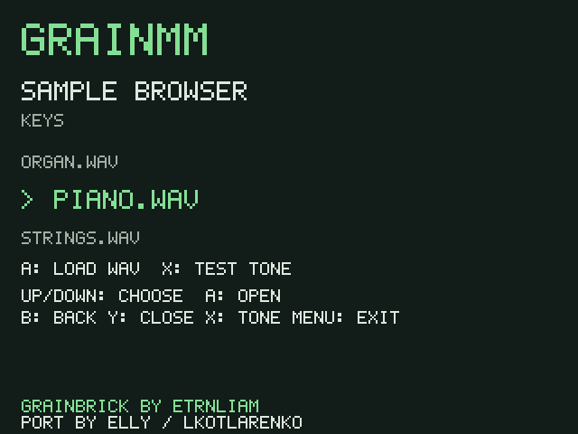

# GrainMM

A granular synthesizer for **Miyoo Mini Plus running OnionOS**. Load a WAV, reshape it with granular playback, layer a built-in synthesizer, and add EQ, compression, tape-style coloration, delay and reverb.
Control everything with the D-pad and buttons.

**Created and maintained by [elly (@lkotlarenko)](https://github.com/lkotlarenko).**
An independently written native adaptation of
[GrainBrick](https://github.com/ETRNLIAM/GrainBrick), by **ETRNLIAM**.

*Grain controls from an earlier build, captured with the actual host renderer.
The example filename is illustrative; samples are not included.*

## Status

**Early alpha. No public download yet.**
This repository publishes documentation. Native source and app downloads are
being kept private while development and testing continue. Granular
playback, sample browsing, synthesis, EQ, compression, delay, reverb and tape-style
coloration work on a real Miyoo Mini Plus. Controls, clean short listening,
save/reopen and normal exit have been checked on the device.
This version does not yet include all GrainBrick features. Recording, MIDI,
shimmer, layered projects and other features are still to come.

Tested system: **Miyoo Mini Plus · OnionOS 4.3.1-1**. Other models are untested.

## Why a native version?

GrainBrick's supplied DSP libraries target a different, 64-bit ARM device. The
Miyoo runs 32-bit ARM with 128MiB RAM, so copying the original app could not make
it work. We built a new C++ audio engine, button-driven interface and OnionOS
adapters for this hardware. GrainMM aims for good sound and useful feature
coverage; it does not promise identical DSP or compatible GrainBrick projects.

Read [the porting story and differences](docs/ABOUT_GRAINMM.md) for what we rebuilt,
the hardware challenges and where the project is going.

## Install

1. Open [Releases](https://github.com/lkotlarenko/GrainMM/releases) and download
   **GrainMM-…-miyoo-mini-plus.zip** under **Assets**. Choose the app ZIP,
   not **Source code**. If there are no releases, a download is not available yet.
2. Turn off your Miyoo and connect its SD card to your computer.
3. Extract the ZIP onto the SD card. Check that `config.json` is at
   **`App/GrainMM/config.json`**, without an extra folder around `App`.
4. Safely eject the card, put it back, and open **Apps → GrainMM**.

Already installed? Follow the [update guide](docs/INSTALLATION.md#update-without-losing-your-sounds)
to keep your sounds and settings.

## Play

GrainMM starts silent. Keep the listening volume low and press **A** to hear
the built-in test tone. Press **A** again to pause.

To use your own sound:

1. Copy a short **16-bit PCM WAV** into **`App/GrainMM/state/`** on the SD card.
   Create `state` if it does not exist. You can organize sounds into subfolders.
2. Open GrainMM and press **Y**. Choose a file with **↑/↓**, then press **A**
   to load it. Use **A** to open a folder and **B** to go back.
3. Press **A** again to play. Change the controls with the D-pad.
4. Press **MENU** to save your settings and exit. The selected sound returns
   next time, paused.

*Sample browser captured with the same host renderer; example filenames only.*

## Controls

| Button | Action |
| --- | --- |
| **A** | Play or pause |
| **↑ / ↓** | Select a parameter |
| **← / →** | Change the selected value |
| **X** | Next control page |
| **L / R** | Previous / next control page |
| **Y** | Open the sample browser; playback pauses |
| **START** | Open patch slots |
| **B** | Waveform with a loaded WAV; back in dialogs |
| **SELECT** | Help for the current page |
| **MENU** | Save and exit to Onion |

In the browser, **A** opens a folder or loads a sound, **B** goes back,
**Y** closes the browser, and **X** selects the test tone.

Grain controls change the size, density, pitch and position of the sound fragments.
Press **X** for delay or reverb controls and raise **MIX** above zero to hear them.
The EQ page changes six frequency bands. MOTION adds reverse grains, pitch/size/
timing variation, stereo spread and sample scanning. Lower GRAIN/GAIN before large EQ boosts.

## Play without a WAV

Press **Y**, then **X** for the built-in source. On the **OSC** page, raise
**LEVEL** to about **0.05**, then press **A**. Select **WAVE** to try sine,
triangle, saw or pulse. **MIDI NOTE 57** is A 3; **69** is A 4.

*Actual host-rendered interface, shown paused.*

The pages are **GRAIN · DELAY · EQ · REVERB · MOTION · OSC · COMP · TAPE · RESONATE · RHYTHM · SAMPLE**.
Use **L/R** to move between them. The oscillator can also play alongside a WAV.
**COMP** controls compression; start with MIX 0 and raise it gradually. Lower
GRAIN/GAIN before large EQ boosts or makeup gain. The quiet test tone at OSC/LEVEL 0
bypasses effects; raise LEVEL for synthesis through the rack.

## Tape-style sound

Open **TAPE** with L/R. Start with **MIX 0.50**, **DRIVE DB 6** and
**OUTPUT DB −6**. DRIVE adds grit, TONE darkens the sound, WOW adds slow pitch
movement, and FLUTTER adds faster movement. Set MIX to zero for the original sound.
This works with a WAV or the built-in synth; the quiet fallback test tone bypasses effects.

## More sound tools

- **RESONATE** adds tuned ringing. Start with MIX0.4 and match MIDI NOTE to your synth.
- **RHYTHM** adds pulsing and stereo movement. Try TREMOLO0.6 at TEMPO120.
- **SAMPLE** trims the playback region without changing your WAV. Raise ENV BLEND
  to use its ATTACK and RELEASE controls. These affect new grains.
- **SELECT** opens help. A can still stop/play audio; B or SELECT closes help.

The effects and sample controls have passed device listening and save/reopen
checks. Longer reliability testing remains.

## Patches and visual trim in alpha10

Press **START** for16patch slots. **X** saves your sound, **A** loads, and **Y**
chooses a name for the next save. To replace a patch, release X and press it again.
**B/START** closes the menu; patch browsing pauses audio.

With a WAV loaded, press **B** for the waveform. Use the D-pad to select and edit
sample trim/window controls; **A** plays/pauses, **B** returns. Your WAV stays intact.
These alpha10 additions are being tested. See the [sound guide](docs/PARAMETERS.md).

## Help

- [Installation, updates and backups](docs/INSTALLATION.md)
- [Sounds, patches and waveform guide](docs/PARAMETERS.md)
- [Troubleshooting](docs/TROUBLESHOOTING.md)
- [Report a problem](https://github.com/lkotlarenko/GrainMM/issues)

## Credits and development

**GrainMM design, native implementation and Miyoo adaptation by
[elly (@lkotlarenko)](https://github.com/lkotlarenko).**
**Original GrainBrick by [ETRNLIAM](https://github.com/ETRNLIAM).**
Porting and distribution permission granted with attribution.

New GrainMM code uses the [GPLv3 license](LICENSES/GPL-3.0-only.txt);
[upstream and third-party terms remain separate](LICENSE_SCOPE.md).
See [credits](docs/CREDITS.md) for authorship, references and acknowledgements.
Source and engineering notes will be published when ready. For now, follow
development here and report issues or ideas through GitHub.
