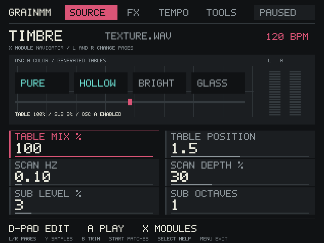
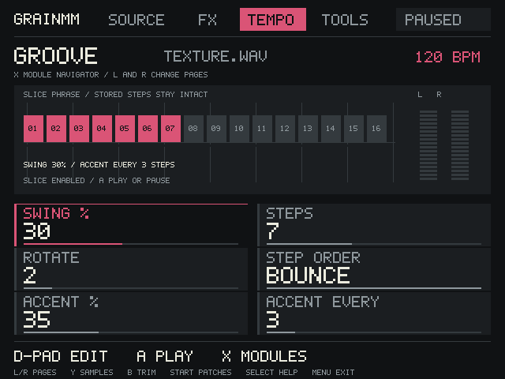
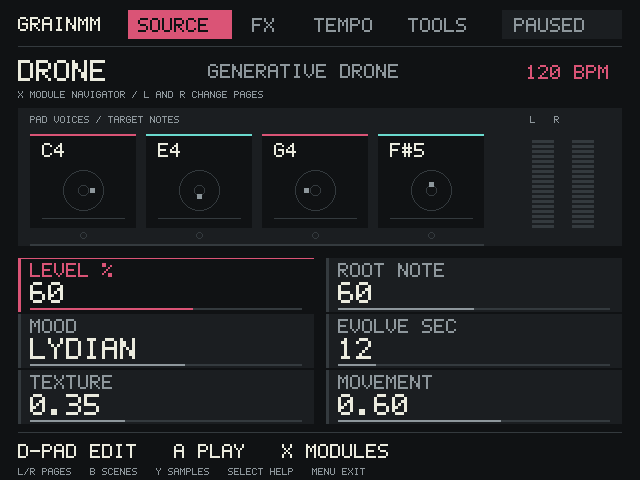
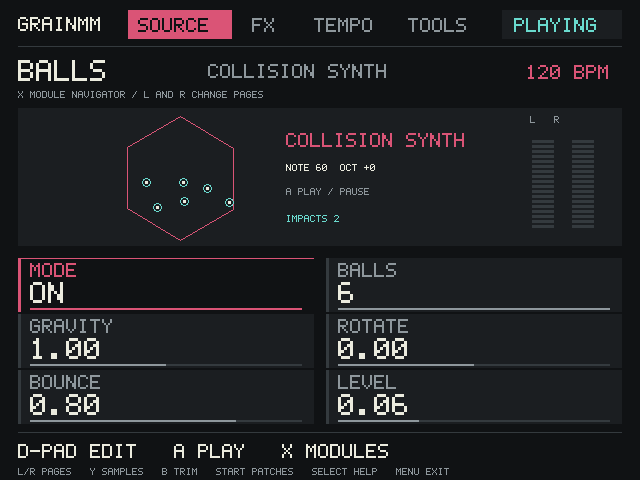

# GrainMM

### A little handheld. A whole world of sound.

**Granular textures · evolving drones · playful rhythms · pocket synthesis**

For **Miyoo Mini Plus + OnionOS**

[Get started](#your-first-sound) · [Install](docs/INSTALLATION.md) · [Sound guide](docs/PARAMETERS.md) · [Help](docs/TROUBLESHOOTING.md)

*Current native interface rendered on the host. Synthetic example; samples are not bundled.*

GrainMM turns your Miyoo into a button-controlled sound instrument. Stretch a
short WAV into a cloud of grains, build a chopped loop, let a drone unfold, or
layer synthesizers and effects. No keyboard or music theory required.

Made by **[elly (@lkotlarenko)](https://github.com/lkotlarenko)**, inspired by
**[GrainBrick by ETRNLIAM](https://github.com/ETRNLIAM/GrainBrick)**, with permission
and attribution. GrainMM has its own independently written native engine.

## Before you start

**1.0.0-alpha.1 is an experimental prerelease.**
[Download the Miyoo app ZIP](https://github.com/lkotlarenko/GrainMM/releases/tag/v1.0.0-alpha.1) · [Read the release notes](docs/releases/1.0.0-alpha.1.md)
The 1.0 number marks a major feature milestone; this is still an experimental
alpha. The accepted physical-device build is alpha25 on OnionOS 4.3.1-1. The new
1.0 features need their own device validation before release.

This targets the **Miyoo Mini Plus**, not the Mini, Flip or other handhelds.
You need OnionOS, an SD card and your own short WAV files if you want to sample.
Built-in synthesis works without samples. [Current testing status →](docs/PORTING_PROGRESS.md)

## What can I make?

| Play with… | Make… |
| --- | --- |
| **Granular sampler** | Ambient clouds, reversed textures, shimmering pitch patterns and moving soundscapes from a WAV |
| **Slice sequencer** | Chopped loops with editable cuts, rests, reverse and per-step chance |
| **Dual oscillators** ✦ | Layered tones, octaves, fifths and detuned sounds with separately tuned OSC and OSC B |
| **Wavetable color** ✦ | Smooth blends between pure, hollow, bright and glassy spectra, with automatic movement |
| **Sub oscillator** ✦ | A sine foundation one or two octaves below OSC |
| **Groove controls** ✦ | Swing, 1–16-step phrases, rotation, reverse/bounce order and repeating accents |
| **Generative drones** | Self-playing pads and melodic events, eight moods and eight starting scenes |
| **Collision instrument** | Tuned notes from balls bouncing inside a bowl |
| **Effects and master output** | Filters, EQ, tape color, digital grit, chorus, compression, rhythm, delay, reverb and optional limiting |
| **Patches and WAV export** | Save sounds in 16 slots, recall an experiment, and render your sound to a new WAV |

✦ New in the 1.0 development milestone. [Explore every control →](docs/PARAMETERS.md)

## Install

Install the experimental alpha:

1. Download **GrainMM-…-miyoo-mini-plus.zip** from [Releases](https://github.com/lkotlarenko/GrainMM/releases). Choose the app ZIP, not the source archive.
2. Turn the Miyoo off and put its SD card into your computer.
3. Extract onto the card. You should have **App/GrainMM/config.json**.
4. Safely eject, put the card back and open **Apps → GrainMM**.

No terminal or firmware changes are needed. **Updating? Back up the whole app
folder first.** New features still need device listening and long-session checks.
[Full installation, update and rollback guide →](docs/INSTALLATION.md)

## Your first sound

GrainMM starts **paused**. Set the listening volume low. Press **A** for a gentle
test tone, then **A** again to pause. You have sound!

**Try a sample:**

1. Copy a short **16-bit PCM WAV** into **App/GrainMM/state/WAV/** on the SD card. Create the folders if needed.
2. Open GrainMM. Press **Y**, choose WAV with **↑/↓**, then **A**.
3. Choose your file and press **A** to load. Press **A** again to play.
4. Try changing **SIZE MS**, **DENSITY HZ** and **POSITION** with the D-pad.
5. Press **MENU** to save your settings and exit.

A grain is a tiny piece of the sample. Many overlapping grains turn a simple
sound into a texture. Your original WAV stays unchanged.

**No sample? Try a drone:** choose **Y → X** for the built-in source. Open
**X → SOURCE → DRONE → A**, raise **LEVEL** to about **60%**, and press **A**.
Try MOOD MAJOR or LYDIAN. Press **B** on DRONE for starting scenes. Keep OSC and
OSC B levels and TIMBRE/SUB LEVEL at zero, and BALLS off, for drone alone.

## Find your way around

**X** opens four groups: **SOURCE** makes sound, **FX** shapes it, **TEMPO** sets
speed and groove, and **TOOLS** holds export, patches, master output and colors.
Use **L/R** to pick a group, **↑/↓** to choose, and **A** to open. SOURCE has two
banks; keep moving down to reach OSC B and TIMBRE. **B** returns.

| Button | On the main sound controls |
| --- | --- |
| **A** | Play / pause |
| **↑ / ↓** | Choose a control |
| **← / →** | Change its value; hold to repeat |
| **L / R** | Previous / next page |
| **X** | Open modules |
| **Y** | Browse samples |
| **START** | Save / load named patches |
| **SELECT** | Help for this page |
| **B** | Pattern editor on SLICE; drone scenes on DRONE/GENERATE; export on OUTPUT; otherwise sample trim when a WAV is loaded |
| **MENU** | Save settings and exit |

Hold **START + SELECT** for about a second, then release both, for reset choices.
**X** confirms; **B** cancels. Samples and saved patches stay intact.

For a temporary undo point: hold **SELECT first**, tap **A** to capture your sound,
then release. Later hold SELECT and tap **B** to recall. This slot disappears on
exit or source loading. Use patches to keep a sound between sessions.

## Save a sound, make a WAV

**Keep a patch:** press **START**, select one of 16 slots, then **X** to save.
Replacing a used slot needs a second X press. **A** loads; **Y** edits the next
save's name. Patches refer to your samples, so back up the whole **state** folder.

**Make a WAV:** open **X → TOOLS → EXPORT WAV → A**, choose 5, 15, 30 or 60 seconds
with **←/→**, then press **A**. Files appear in **state/exports/** with new numbered
names. **B** cancels. Export renders the sound from a fresh start; it is not a
recording of your button presses. Playback stays paused afterward.

You can load a 5-, 15- or 30-second export back through **Y → exports** for another
round of sampling. A 60-second stereo export exceeds the current loading limit.

## Know the limits

- **No Bluetooth on a stock Miyoo Mini Plus:** no Bluetooth MIDI keyboard or Bluetooth headphones. GrainMM has no MIDI input, output, network sync or external clock support. Wi-Fi does not add those features.
- **No live input or recording.** Load WAVs from the SD card; use offline export to make new ones. USB audio and USB MIDI are unsupported.
- **WAV only:** 16-bit PCM, mono or stereo, 8–96 kHz. No MP3, 24-bit or float WAV. Decoded samples must fit within **16 MiB**: about **43 seconds stereo at 48 kHz**. Short samples are the easiest starting point.
- **One sample at a time.** Sources share one effects chain. This is not a multitrack DAW and does not open GrainBrick projects.
- **Stereo needs headphones or an external stereo destination.** The built-in speaker cannot reveal stereo width or panning. Bluetooth audio hardware modifications are outside this project's support.
- **Save before powering off.** Press MENU and let the app exit. Sleep/power interruption and long-session reliability are still under test.
- **Keep levels sensible.** Layering sources and boosting effects can clip. MASTER OUTPUT has an optional sample-peak limiter; it cannot guarantee every possible peak is prevented.

Hardware context: [Miyoo Mini Plus Bluetooth hardware modification project](https://github.com/MagneFire/mmp-kcx).
App limitations and tested scope: [platform](docs/TARGET_PLATFORM.md) · [release readiness](docs/development/RELEASE_READINESS.md).

## A look inside

| Wavetable color and sub bass | Swing and phrase controls |
| :---: | :---: |
|  |  |

*Actual 1.0 host-rendered screens using synthetic example data; not device photos.*

| Generative drones | Collision instrument |
| :---: | :---: |
|  |  |

*Current native host-rendered screens; not photographs of the handheld.*

## What's next

- **First, prove the new sounds on hardware:** dual/table/sub listening, groove,
  headphone/speaker checks and longer sessions on the Miyoo.
- **Make it dependable:** resource profiling, repeated loads/saves/exports and
  power/sleep/error recovery.
- **Then build more ways to play:** practical parameter automation, richer ambient
  steering and routing, improved resampling and independent grain layers.

Shimmer and deeper arrangements are ideas under evaluation. These are priorities,
not promised release dates. MIDI, live input and unsupported hardware connections
remain outside the current feature set. [Detailed roadmap →](docs/development/ROADMAP.md)

## Go deeper

[Sound recipes and every control](docs/PARAMETERS.md) · [Installation and backups](docs/INSTALLATION.md) ·
[Troubleshooting](docs/TROUBLESHOOTING.md) · [Documentation](docs/README.md) ·
[Report a problem](https://github.com/lkotlarenko/GrainMM/issues)

**GrainMM: elly (@lkotlarenko). Original GrainBrick: ETRNLIAM.**
[Credits](docs/CREDITS.md) · [GPLv3 for new GrainMM work](LICENSE_SCOPE.md).
Original and third-party materials retain their separate terms.
