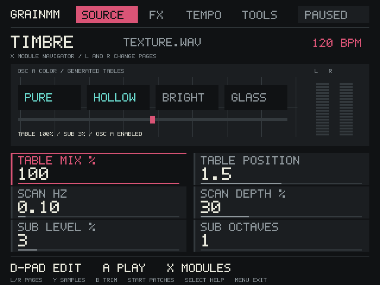
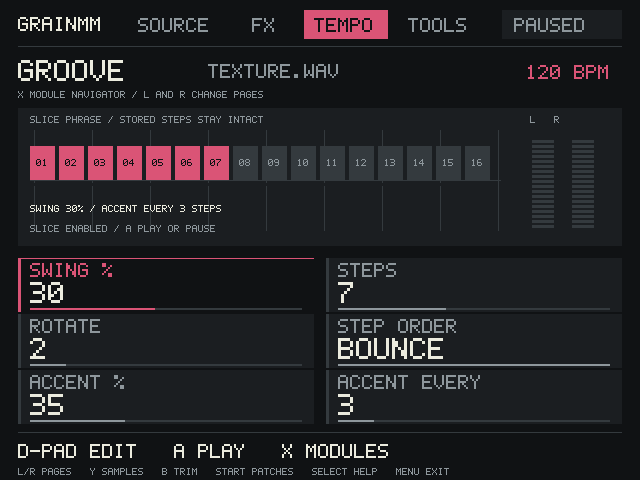

# GrainMM 1.0.0-alpha.1 — pocket synthesis and groove

First public native GrainMM prerelease for Miyoo Mini Plus / OnionOS.
The major number marks a feature milestone, not stable acceptance.

## New musical features

- **Dual oscillators:** independently tune/layer OSC and OSC B, each with four waves,
  stereo detune, pulse width and vibrato.
- **Generated wavetable morphing:** four original harmonic spectra on OSC A with
  smooth position blends and automatic scan; upper partials reduce at high pitches.
- **Sub bass:** independent-level mono sine one or two octaves below OSC A.
- **Swing:** delays alternating WAV slice steps while preserving pair duration.
- **Variable phrases:** play 1–16 steps without erasing the remaining pattern.
- **Pattern variations:** rotate phrases and choose forward, reverse or bounce.
- **Repeating accents:** soften non-accented steps with editable depth/interval.

New controls are saved in settings, named patches, snapshots and full-mix exports.
SOURCE now uses two explicit banks; GROOVE lives in TEMPO. Existing FX/TOOLS and
accepted pattern/export workflows remain in place.

## Updating and limits

Back up the entire app folder before updating. New saves use parameters.v18 with
150 scalar controls plus the pattern; older settings1–17 remain for rollback.
Newly saved patches need the new version. Restore a full old state backup when
rolling back. Playback always starts paused.

WAV slices alone use GROOVE. TIMBRE colors oscillator A; oscillator B remains
independent. Tables are generated, not imported. No Bluetooth/MIDI, USB audio,
live input/recording, multitrack or GrainBrick-project support. The 16 MiB decoded
sample cap remains; 60-second exports cannot be loaded back.

## Validation and release status

[Validation](../development/V1_VALIDATION.md) records the tested source and results;
[readiness](../development/RELEASE_READINESS.md) tracks remaining gates. Alpha25
remains the accepted physical build until the new candidate is separately tested.
New1.0features have host/sanitizer/ARM evidence; separate physical acceptance
remains pending because the device was unreachable during preparation. Longer
stress, headphones/speaker, power/sleep and VNC-off resource checks remain open.
This release is experimental and does not claim stable reliability.

GrainMM by elly (@lkotlarenko). Original GrainBrick by ETRNLIAM, with permission
and attribution. New work GPL-3.0-only; earlier MIT grants and separate third-party
terms remain preserved.

## Install and keep your sounds

Download **GrainMM-1.0.0-alpha.1-miyoo-mini-plus.zip**, back up any existing app
folder, then extract to the SD card so App/GrainMM/config.json exists. Open
Apps → GrainMM. Starts paused: keep volume low and press A. The matching
**GrainMM-1.0.0-alpha.1-source.tar.gz** is for developers; each asset has a SHA256
file. [Installation and rollback](../INSTALLATION.md).

## Screens

Actual host-rendered screens, not photographs of the handheld.

## What's next

Hardware listening/usability for the new synthesis/groove, measured resource
headroom and longer save/export/power recovery tests come first. Then practical
parameter automation, richer ambient steering/routing, improved resampling and
independent grain layers. Shimmer/deeper arrangements remain ideas under evaluation.
[Roadmap](../development/ROADMAP.md). No release dates are promised.

Older0.1alpha notes in the repository describe local development checkpoints,
not a previously published GrainMM native release series.
